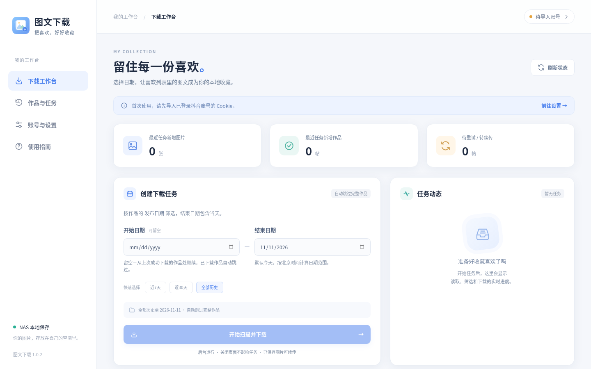
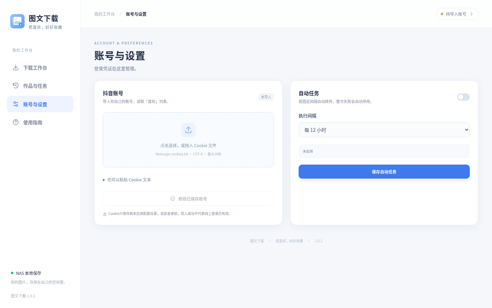
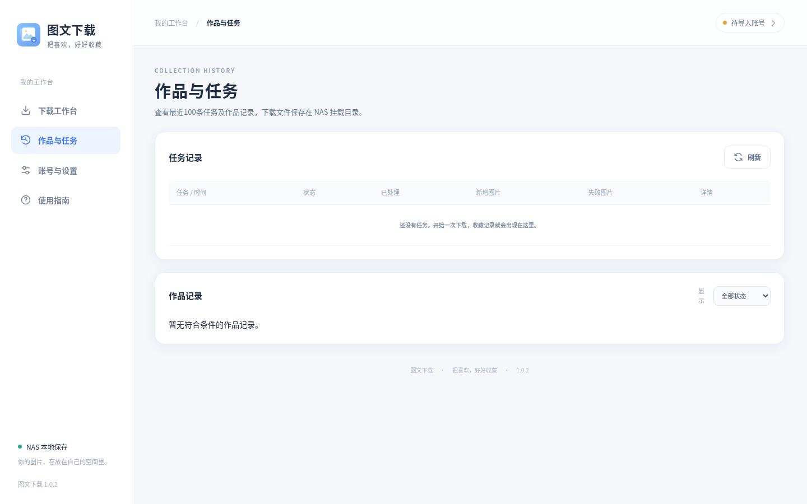
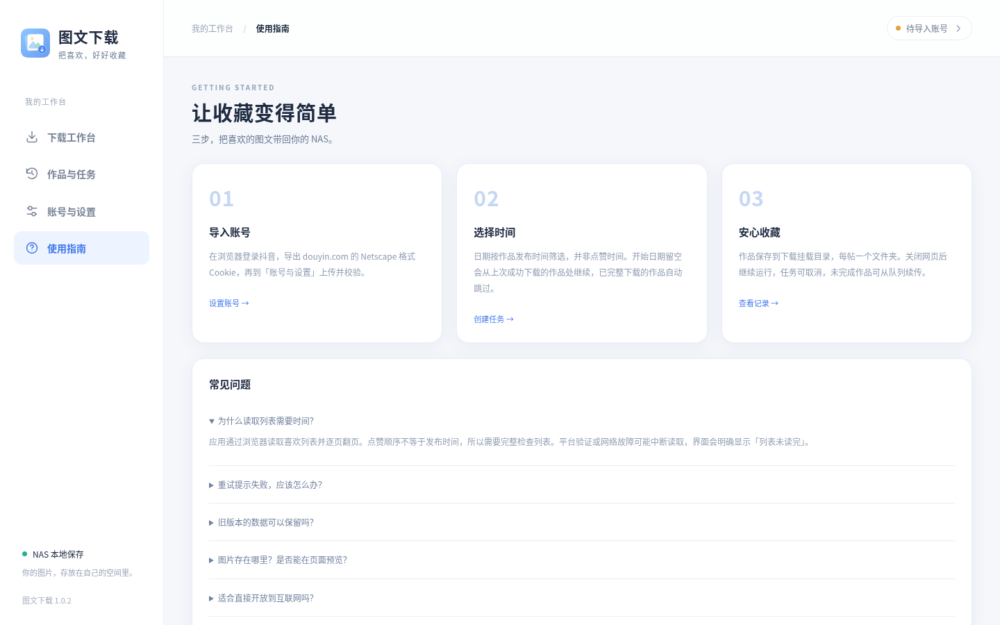
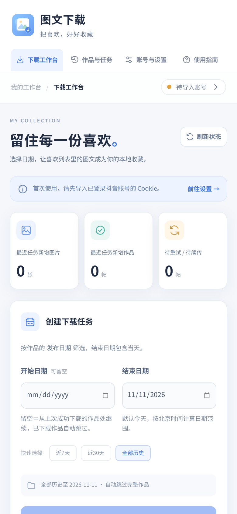

# 图文下载 · tuwen-xiazai

把抖音「喜欢」列表里的**图文帖**自动下载到自己的 NAS，支持断点续传、定时自动任务和失败分级处理。

一个容器即可运行，数据全部保存在本地挂载目录，不经过第三方服务器。



## 功能

- **图文提取**：读取账号喜欢列表，按作品发布时间筛选图文帖，保存全部图片与原帖链接
- **断点续传**：开始日期留空时，从上次成功任务的最新作品处继续，扫到断点即停，不重复扫全量
- **自动任务**：可设置每 12 小时 / 24 小时 / 自定义间隔自动执行，配置持久化
- **错误分级**：
  - 单个作品/单张图片失败 → 记录到任务详情和失败队列，任务继续，定时任务继续
  - 整次任务失败（Cookie 失效、列表取不到等）→ 任务报错并**自动停用定时任务**，界面显示停用原因
- **失败重试**：未完成的图片可从队列续传，已下载的图片自动跳过
- **账号校验**：导入 Cookie 后可在线校验登录是否仍有效
- **任务与作品记录**：最近任务、处理数量、失败数量、作品状态一目了然
- **本地优先**：无云端依赖，图片、数据库、Cookie 都在自己的目录里

## 界面

| 账号与设置 | 作品与任务 |
|---|---|
|  |  |

| 使用指南 | 手机端 |
|---|---|
|  |  |

## 快速开始

镜像已发布到 Docker Hub：`jieyousuozhang/tuwen-xiazai:latest`（linux/amd64）。

新建 `docker-compose.yml`：

```yaml
services:
  tuwen-xiazai:
    image: jieyousuozhang/tuwen-xiazai:latest
    container_name: tuwen-xiazai
    restart: unless-stopped
    init: true
    ports:
      - "8898:8000"
    environment:
      TZ: Asia/Shanghai
      CHROMIUM_PATH: /usr/bin/chromium
      DOUYIN_DOWNLOAD_ROOT: /downloads
      DOUYIN_CONFIG_DIR: /app/config
      DOUYIN_DATA_DIR: /app/data
      DOUYIN_LOG_DIR: /app/logs
    volumes:
      - ./config:/app/config
      - ./data:/app/data
      - ./logs:/app/logs
      - ./downloads:/downloads
    shm_size: 1g
```

```bash
mkdir -p config data logs downloads
docker compose up -d
```

打开 `http://<NAS_IP>:8898`。

> 也可直接从源码构建：`docker build -f Dockerfile -t tuwen-xiazai .`

## 首次使用

1. 浏览器登录抖音，导出 `douyin.com` 的 **Netscape 格式** `cookies.txt`
2. 进入「账号与设置」，上传或粘贴 Cookie，点「校验已保存账号」
3. 到「下载工作台」，结束日期默认今天，开始日期可留空，点「开始扫描并下载」

## 使用说明

### 日期与续传

- 日期按**作品发布时间**筛选，不是点赞时间
- 开始日期留空 = 从上次成功任务的最新作品处继续；第一次使用（没有历史）才会扫描全部历史
- 已完整下载的作品自动跳过，半截作品会补齐缺失图片

### 自动任务

在「账号与设置 → 自动任务」中开启，选择间隔（12 小时 / 24 小时 / 自定义 0.5–168 小时）。

- 到期时若已有任务在运行，会等它结束再执行，不会并发
- 每次执行都从上次成功的位置继续
- 整次任务失败会自动停用，并在卡片上显示原因；处理后可手动重新开启

### 目录结构

| 挂载 | 作用 |
|---|---|
| `./config` | Cookie 与配置，**务必备份** |
| `./data` | SQLite：任务、作品、续传队列 |
| `./logs` | 日志目录 |
| `./downloads` | 下载的图片，每帖一个文件夹 |

下载结果示例：

```
downloads/
└── 作者名_76901234567/
    ├── img_01.webp
    ├── img_02.webp
    └── share_url.txt
```

## 环境变量

| 变量 | 默认值 | 说明 |
|---|---|---|
| `TZ` | `Asia/Shanghai` | 时区，影响日期与定时任务 |
| `CHROMIUM_PATH` | `/usr/bin/chromium` | 浏览器路径 |
| `DOUYIN_DOWNLOAD_ROOT` | `/downloads` | 图片保存根目录 |
| `DOUYIN_CONFIG_DIR` | `/app/config` | Cookie 与配置目录 |
| `DOUYIN_DATA_DIR` | `/app/data` | 数据库目录 |
| `DOUYIN_LOG_DIR` | `/app/logs` | 日志目录 |

## 项目结构

```
.
├── app/
│   ├── main.py              # FastAPI 入口、静态资源、健康检查
│   ├── config.py            # 路径与超时配置
│   ├── douyin/              # 浏览器客户端：读取喜欢列表、下载图片
│   ├── routers/             # 账号 / 扫描 / 自动任务 API
│   ├── services/            # 任务编排、下载、数据库、Cookie、调度器
│   └── models/              # 数据模型
├── web/static/              # 单页前端（HTML/CSS/JS/图标）
├── Dockerfile               # 完整构建（Python + Chromium）
├── Dockerfile.nas           # 复用已有镜像的增量构建
├── docker-compose.yml
└── requirements.txt
```

## 数据与隐私

- 镜像**不包含** Cookie、数据库、API Key 或任何下载的图片
- 所有数据只写入你挂载出来的本地目录
- 应用不向任何第三方服务器发送数据
- 适合在可信局域网运行；默认无登录鉴权，不要直接暴露到公网，如需外网访问请套带认证的反向代理或 VPN

## 常见问题

**为什么第一次读取喜欢列表很慢？**

应用通过真实浏览器逐页翻喜欢列表，点赞顺序不等于发布时间，需要完整翻页才能保证不漏帖。

**提示「列表未读完」怎么办？**

平台验证或网络异常会中断读取。稍后重试；持续出现请重新导出 Cookie。

**重试提示失败怎么办？**

先确认下载目录可写、网络正常，再重新扫描相同范围；CDN 链接会刷新，已下载图片会自动跳过。

**会自动删除旧数据吗？**

不会。升级不会删除历史任务、作品或下载目录。

## 版本

当前版本：**1.0.2**

## 许可证

本仓库未附带开源许可证。如需商用或二次分发，请先联系作者。
